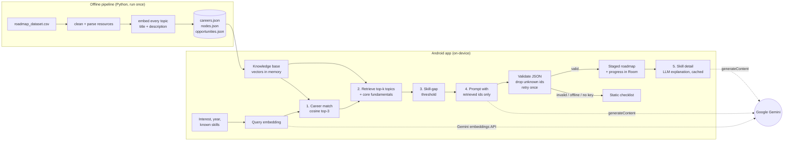

# TechPath

TechPath is an Android research prototype for technology students (Strathmore University, BICS, Research
Methodology unit). It puts three things in one app:

- **AI Career Roadmap**: a personalised, staged skills roadmap for a chosen tech career.
- **Opportunities**: internships, attachments and entry-level jobs, with application tracking.
- **Career Information Hub**: short practical guides on CVs, interviews, LinkedIn, GitHub and more.

The research question is whether a personalised, AI-generated roadmap improves career readiness compared
with a well-designed static roadmap. The app therefore has two **study modes**, *AI* and *Static*, that
otherwise look the same.

---

## Method: Retrieval-Augmented Generation (RAG)

No model is trained or fine-tuned. The "training" is a one-off offline step that precomputes embeddings
for the curated roadmap.sh knowledge base (91 career paths, 10,321 topics after cleaning). At run time:

1. **Career matching**: the student's free-text interest is embedded and compared by cosine similarity with
   each career-path vector. The top 3 are shown with scores, and the student confirms one. A typed path
   name (e.g. "Backend") matches directly.
2. **Retrieval**: the path's topics are ranked by cosine similarity to the student's goal. The top 28 are
   kept, plus the path's core fundamentals and any skills the student already has.
3. **Skill gap**: the student's known skills are embedded. A topic whose similarity reaches the threshold
   (tunable in Settings; 0.80 for Gemini embeddings) is marked *already known*. Picked chips and exact
   title matches count too. Known topics are collapsed and marked done, not hidden.
4. **Generation**: the retrieved topics (id, title, short description), goal, year of study and known
   skills go to Gemini, which returns **strict JSON** with 4 to 6 stages of ordered topic ids, each with a
   one-line "why now". The app drops any id outside the retrieved set, removes duplicates, retries once
   with a repair prompt if the JSON is invalid, and **falls back to Static mode** if it fails again.
5. **Skill detail**: *What it means / What it involves / Why it matters for <career>*, generated on demand
   from the topic's dataset description and cached in Room, followed by the topic's resource links.



### Embeddings

| Build | Embedding model | Query embedding on the phone |
|---|---|---|
| With `GEMINI_API_KEY` (recommended for the study) | `gemini-embedding-2`, 768 dims | Gemini API, same model |
| Without a key (what is committed now) | `hash-tfidf-v1`, 512 dims: a deterministic lexical fallback (hashed words, bigrams and synonym expansions, IDF weighted) | On-device, identical Kotlin port |

`careers.json` records which embedder built the assets, and the app always embeds queries the same way.
The hash fallback lets the APK build and run with no key at all. It is lexical, though, so **rebuild the
assets with Gemini embeddings before running the study** (see below). The Python and Kotlin hash
implementations are checked against each other by a unit test.

Default text model: `gemini-3.8-flash` (fast, on the free tier). You can change it in **Settings → AI
settings**, or change `DEFAULT_TEXT_MODEL` in `app/build.gradle.kts`. All prompts are in one file:
[`core/src/main/kotlin/com/techpath/core/Prompts.kt`](core/src/main/kotlin/com/techpath/core/Prompts.kt).

---

## Repository layout

```
pipeline/            Offline data pipeline (Python)
  build_assets.py    CSV -> app/src/main/assets/{careers,nodes,opportunities}.json
  embedders.py       Gemini + hash-tfidf embedders
  path_descriptions.py  display names + short descriptions per career path
  data/              sample opportunities, hash lexicon
  pipeline_report.txt   row counts per step and asset sizes from the last run
core/                Pure Kotlin/JVM: retrieval, skill gap, prompts, LLM JSON validation (+ unit tests)
app/                 Android app (Kotlin, Jetpack Compose, Material 3, MVVM)
  data/              KnowledgeBase, GeminiClient, RoadmapRepository, Room DB, settings, event logger
  ui/                onboarding, roadmap, opportunities, hub, settings screens
  src/main/assets/   generated knowledge base + Markdown career articles
```

Architecture: single activity, Navigation Compose, ViewModels with `StateFlow`, coroutines, Room,
DataStore, OkHttp + kotlinx.serialization, and manual DI (`AppContainer`). minSdk 26, compileSdk 37,
AGP 9.4, Kotlin 2.4, Gradle 9.6.

---

## Build the app

Requirements: Android Studio (current stable) or JDK 17+ with the Android SDK.

```bash
git clone https://github.com/Tums2060/techpath-android.git
cd techpath-android
./gradlew :core:test      # unit tests
./gradlew assembleDebug   # APK at app/build/outputs/apk/debug/app-debug.apk
```

Android Studio writes `local.properties` with your `sdk.dir`. For a command-line build, copy
`local.properties.example` to `local.properties` and set `sdk.dir`.

Every push also builds on GitHub Actions (`.github/workflows/android.yml`), and the debug APK is attached
to the run as the **techpath-debug-apk** artifact.

## Add the Gemini API key

1. Get a free key at <https://aistudio.google.com/apikey>.
2. In the app, open **Settings → Gemini API key**, paste the key and tap **Save key**. It is encrypted with an
   Android Keystore key and stored in DataStore. It never appears in source code.
3. *(Optional, debug builds only)* put `GEMINI_API_KEY=...` in `local.properties` to pre-fill it. That file is
   git-ignored. Release builds never contain a key.

Without a key, or offline, the app runs in Static mode automatically.

## Re-run the data pipeline

```bash
cd pipeline
python -m venv .venv && source .venv/bin/activate     # Windows: .venv\Scripts\activate
pip install -r requirements.txt
export GEMINI_API_KEY=your_key                         # Windows: set GEMINI_API_KEY=your_key
python build_assets.py --csv /path/to/roadmap_dataset.csv
```

- `--embedder auto|gemini|hash` (default `auto`: Gemini if the key is set, otherwise hash).
- `GEMINI_EMBED_MODEL` (default `gemini-embedding-2`) and `GEMINI_EMBED_DIMS` (default `768`) override
  the model.
- Without `--csv` the script looks for `roadmap_dataset.csv` in the repo and its parent folder.
- A Gemini run embeds about 10,400 texts in batches of 100. Expect a few minutes; it retries on rate
  limits.
- Outputs go to `app/src/main/assets/`. Rebuild the app afterwards.

Cleaning steps, in order (counts from the last run are in `pipeline/pipeline_report.txt`): trim whitespace,
drop exact duplicate rows, drop rows with no `node_id`, drop duplicate `(career_path, node_id)`, drop the
`r-programming` alias of `r`, clean Markdown/HTML out of the text, drop empty titles/descriptions, drop
duplicate descriptions within a path, fix mislabelled duplicate titles from the slug, then parse resources
into `{title, url, type}`.

Asset sizes: with the hash fallback, `nodes.json` is 23.3 MB uncompressed, and the bundled assets come to
about 5.3 MB compressed inside the APK. A Gemini 768-dim build has denser vectors that compress less, so
expect roughly 30 MB uncompressed and a larger APK. Vectors are stored as little-endian float16, base64
encoded.

---

## Study modes

| | AI mode | Static mode (control) |
|---|---|---|
| Career selection | free-text interest → top-3 matches with similarity scores (or browse all) | plain list of all 91 paths |
| Roadmap | 4–6 personalised stages, LLM-ordered, "why now" per skill, known skills collapsed | the path's topics as a fixed checklist: core fundamentals, then all topics A–Z |
| Skill detail | LLM sections (means / involves / why it matters) + dataset description | the dataset description |
| Everything else | identical: same screens, progress tracking, resources, opportunities, hub | identical |

The researcher sets the mode in **Settings → Study mode**. Switching rebuilds the roadmap in the new
condition. With AI mode selected, the app falls back to Static mode, and says so on screen, when there is
no key, no network, or the LLM output fails validation. The fallback is logged.

### Research instrumentation

Anonymised events go to Room under a random participant ID (e.g. `P-3F9A12BC`). Each event records the
mode actually in force (AI/Static): onboarding completed, career matched, roadmap generated or fallback,
skill opened, status changed, resource opened, opportunity saved / status changed / link opened, article
opened, mode changed, and time spent in each tab. **Settings → Export data (CSV)** writes them to a file
you choose. The optional name and the profile stay on the device and are never logged or sent.
Cloud backup is disabled for app data.

---

## Opportunities

No live data source exists yet. The tab shows **20 clearly labelled sample listings** for fictional
organisations (`pipeline/data/opportunities_sample.json`) under a "Sample data" banner. Listings come
through the `OpportunitySource` interface, so a real feed can replace `SampleOpportunitySource` later.
The **Relevance** percentage is the cosine similarity between a listing's requirements embedding and the
student's profile (path vector + roadmap topics). It is a ranking aid, not automated job matching.
Applications are never processed in the app: **Apply on website** opens the link, and the student tracks
the status (Saved → Applied → Interviewing → Offer / Rejected) by hand.

---

## Known limitations

- **Sparse resources**: most topics have few links (about 97% have no course, 60% no video, 34% no article);
  1,003 topics have none at all. The app says so and suggests where to look.
- **Sample opportunities** only; organisations and links are fictional.
- **LLM ordering is not validated by experts.** The dataset has no prerequisite or sequence information, so
  stage order and the "why now" lines come from the model. They are constrained to retrieved topics but
  can still be wrong.
- **Core fundamentals are heuristic** (intro/basics titles, topics shared across many roadmaps, centrality),
  not curated.
- The committed assets use the lexical **hash fallback**. Matching on free text ("apps for banks")
  works reasonably but is weaker than semantic embeddings. Rebuild with Gemini for the study.
- The default threshold suits Gemini embeddings. With the hash fallback, known skills are compared with
  topic titles at 0.60 instead.
- Gemini free-tier data may be used by Google to improve its products; the About screen discloses this.
- Some roadmap.sh titles are duplicated or mislabelled in the scrape. The pipeline fixes 83 of them; 144
  identical titles with different content remain.

## Data notes (differences from the brief)

- 10,634 rows and 93 paths, as described. After cleaning, 91 paths remain: `r-programming` is an exact alias
  of `r`, and `code-review` (6 rows) has no `node_id`s and only placeholder titles.
- There are **no exact duplicate rows**, but there are 61 duplicate `(career_path, node_id)` pairs and 84
  duplicate descriptions within a path.
- Missing-value rates match: courses 97.2%, opensource 95.8%, videos 59.6%, official_docs 56.3%,
  articles 34.2%.
- Resource titles can contain `" | "` (e.g. *"Responsible AI | Microsoft Learn"*), so the parser matches
  `title (url)` units instead of splitting on the pipe. 7 URLs were missing the leading `h` (`ttps://`).
- Rows within a path are about 92% alphabetical, adjacent pair to adjacent pair, so there is no learning order.

Roadmap content © roadmap.sh contributors, used for non-commercial research.
