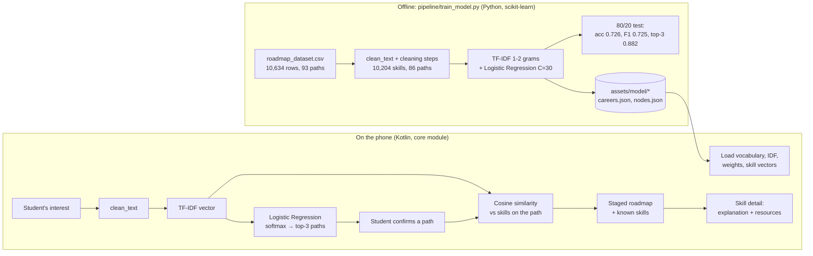

# TechPath (Android)

TechPath is an Android app that helps technology students choose a career path and plan the skills to
learn. A student describes the work they want to do, and the app:

1. predicts the most likely **career paths** (with a probability for each),
2. builds a **staged skills roadmap** for the chosen path, marking skills they already know,
3. explains each skill and links to **learning resources**,
4. lists **opportunities** (internships, attachments, entry-level jobs) ranked by relevance, and
5. offers short **career guides** (CVs, interviews, LinkedIn, GitHub, ...).

All the AI runs **on the phone**, using the machine-learning engine from the `SemProject_MLEngine` project
(TF-IDF + Logistic Regression + cosine similarity). **No API key, no internet connection and no external AI
service are needed.**

Group: Tumaini Wekesa (189813) · Kasongo Wasingya Mediatrice (190013) · Mutemi Hellen Nzisa (179581)

---

## Contents

- [Quick start: run it in Android Studio](#quick-start-run-it-in-android-studio)
- [How the AI works](#how-the-ai-works)
- [Screens and routes](#screens-and-routes)
- [Study modes (AI vs Static)](#study-modes-ai-vs-static)
- [Project structure](#project-structure)
- [Retraining the model (optional)](#retraining-the-model-optional)
- [Tests](#tests)
- [Building from the command line](#building-from-the-command-line)
- [Troubleshooting](#troubleshooting)
- [Data, privacy and limitations](#data-privacy-and-limitations)

---

## Quick start: run it in Android Studio

**You do not need to run any command first.** The trained model and all data files are already in
`app/src/main/assets/`, so Android Studio can build and run the app directly.

### 1. Requirements

| What | Version |
|---|---|
| Android Studio | a recent stable release (it must support Android Gradle Plugin 9.4) |
| JDK used by Gradle | 17 or newer (Android Studio's bundled JDK is fine) |
| Android SDK | Platform **37** (compileSdk) - Android Studio offers to install it |
| Virtual phone (emulator) | any phone image with **API 26 (Android 8.0) or newer**; API 34-36 recommended |

The Gradle wrapper (Gradle 9.6) downloads itself on the first sync. You do **not** need to install Gradle.

### 2. Open the right folder

In Android Studio choose **File → Open** and select the **`techpath-android`** folder itself (the folder that
contains `settings.gradle.kts`, `gradlew` and the `app/` and `core/` folders).

> Do **not** open `app/`, `core/` or the parent `app` folder. Do not open `SemProject_MLEngine` either: that is
> the notebook/research project. The Android project is only `techpath-android`.

### 3. Let Gradle sync

When the project opens, Android Studio runs a **Gradle sync** (bottom status bar). The first one downloads
Gradle and the libraries, so it takes a few minutes and needs internet. If it asks to install missing SDK
components (for example *Android SDK Platform 37*), accept.

Android Studio also creates `local.properties` with the path to your Android SDK. You don't need to edit it.

### 4. Create a virtual phone (if you don't have one)

**Tools → Device Manager → + (Create Virtual Device)** → pick a phone (e.g. *Medium Phone* or *Pixel 8*) →
pick a system image with API 34, 35 or 36 (download it if needed) → **Finish**.

### 5. Run

Select the **`app`** run configuration and your virtual phone in the toolbar, then press **Run ▶**
(Shift+F10). The first launch shows the onboarding screens. Loading the ML model takes a few seconds on an
emulator (longer on the very first launch after a cold emulator boot).

---

## How the AI works

TechPath follows the method in `SemProject_MLEngine/RoadmapSH1_Exploration.ipynb` exactly. There are two
parts: an **offline training step** (Python, already done, output committed in `assets/`) and **on-device
inference** (Kotlin, in the `core` module).



### 1. Data cleaning (same as the notebook)

Starting from `roadmap_dataset.csv` (roadmap.sh, 10,634 rows, 93 career paths):

| Step | Rows left |
|---|---|
| Drop rows with no `title` or `description` | 10,604 |
| Drop exact duplicates, then duplicates of (`career_path`, `title`) | 10,296 |
| Drop descriptions shorter than 10 words | 10,293 |
| Keep only career paths with at least 30 skills (removes 7 small paths) | **10,204 skills, 86 paths** |

Text cleaning (`clean_text`): lowercase → markdown links become their label → remove URLs → remove
roadmap.sh tags like `@official@` → remove markdown symbols → keep only letters, digits and `+ # .` (so
`c++`, `c#`, `.net` survive) → collapse spaces. The model input is `title + ". " + description`.

### 2. Model

- **TF-IDF**: English stop words removed, unigrams + bigrams, `min_df=2`, `sublinear_tf=True`, L2-normalised
  (64,825 features).
- **Logistic Regression** (multinomial/softmax), `C = 30`, `max_iter = 2000`. `C` and the n-gram range were
  chosen by 5-fold stratified grid search in the notebook (best CV macro-F1 0.696).
- **Validation**: 80/20 stratified split, `random_state=42`. Test accuracy **0.726**, macro-F1 **0.725**,
  top-3 accuracy **0.882** (random guessing ≈ 0.012).
- For the app, the model is refitted on all 10,204 skills with the same settings (use `--fit-on train` to
  ship the exact 80% model instead).

### 3. What happens on the phone

| Step | Where it's used | What the engine does |
|---|---|---|
| **Career matching** | Onboarding, Switch career | `clean_text(interest)` → TF-IDF → Logistic Regression → the **top 3 paths with probabilities**. Each card also shows the notebook's **5 closest skills** on that path (cosine similarity). Typing a path name (e.g. "Backend") also puts that path first. |
| **Skill suggestions** | Onboarding step 3 | The path's core topics plus the skills most similar to the interest. |
| **Skill gap** | Roadmap | A skill counts as already known if it was ticked, typed exactly, or a typed skill's TF-IDF vector has cosine ≥ **0.60** with the skill title (adjustable in Settings). Known skills are marked done. |
| **Roadmap** | Roadmap tab | Built from two model signals: **relevance** = cosine(goal, skill), and **typicality** = P(this path given the skill's text) from the classifier. Stages: **Foundations** (core topics, more for years 1-2) → **Closest to your goal** (top-5 cosine, as in the notebook) → **Core skills** → **Go further** (ranked by 0.6·typicality + 0.4·relevance). Every skill has a one-line "why". |
| **Skill explanation** | Skill detail | *What it means* and *What it involves* come from the dataset description. *Why it matters* uses the model's evidence (typicality, which other roadmaps share the skill, whether it's a core topic). |
| **Opportunity relevance** | Opportunities tab | The classifier's probability that a listing (title + requirements + description) belongs to the student's career path. |

**Replacing Gemini.** The previous version used the Gemini API for embeddings, roadmap ordering and
explanations. That has been removed completely: the API-key setting, the network client, OkHttp and the
`INTERNET` permission are gone. Everything above is computed on the device by the trained model.

**Parity with Python.** `core/src/test/.../ModelParityTest.kt` checks that the Kotlin engine gives the same
cleaned text, TF-IDF values, top-3 paths and probabilities, and top-5 skills as scikit-learn for a set of
sample queries. For example, *"I want to build mobile apps for Android phones"* gives Android 0.74,
Data Engineer 0.02, Flutter 0.01 in both.

---

## Screens and routes

The app uses one activity (`MainActivity`) and Jetpack Navigation Compose. Routes are defined in
[`app/src/main/java/com/techpath/app/ui/TechPathRoot.kt`](app/src/main/java/com/techpath/app/ui/TechPathRoot.kt)
(`object Routes`).

**Onboarding** is not a route: `TechPathRoot` shows it until the student finishes it (the `onboarded` flag
in DataStore), then shows the main navigation. To see it again: **Settings → Reset onboarding**.

| Screen | Route | How to get there | File |
|---|---|---|---|
| Onboarding, step 1: About you (name, year 1-5, interest) | *(none)* | First launch / after reset | `ui/onboarding/OnboardingScreen.kt` |
| Onboarding, step 2: Choose a career path (top-3 predictions, or browse all 86) | *(none)* | **Next** | `ui/onboarding/OnboardingScreen.kt`, `CareerChoice.kt` |
| Onboarding, step 3: Skills you already have | *(none)* | **Confirm** | `ui/onboarding/OnboardingScreen.kt` |
| **Roadmap** (start screen, bottom tab) | `roadmap` | **Build my roadmap**, or the *Roadmap* tab | `ui/roadmap/RoadmapScreen.kt` |
| Skill detail | `skill/{path}/{nodeId}` e.g. `skill/android/<nodeId>` | Tap a skill on the roadmap | `ui/roadmap/SkillDetailScreen.kt` |
| Switch career path | `career_picker` | Roadmap → **Switch career** | `ui/roadmap/CareerPickerScreen.kt` |
| **Opportunities** (bottom tab) | `opportunities` | *Opportunities* tab | `ui/opportunities/OpportunitiesScreen.kt` |
| **Resources** / Career hub (bottom tab) | `resources` | *Resources* tab | `ui/hub/HubScreen.kt` |
| Article | `article/{id}` e.g. `article/01-tech-cv` | Tap a guide in Resources | `ui/hub/HubScreen.kt` (`ArticleScreen`) |
| Settings | `settings` | ⚙ icon on any tab | `ui/settings/SettingsScreen.kt` |
| About & AI use | `about` | Settings → **About TechPath & AI use** | `ui/settings/AboutScreen.kt` |

What each screen does:

- **Roadmap**: career name, the *AI (ML) roadmap* or *Static roadmap* badge, overall progress, **Regenerate**
  and **Switch career**. Each stage has its own progress bar; known skills are collapsed under "N skills you
  already know". Tap the circle on a skill to cycle *Not started → Learning → Done*.
- **Skill detail**: "Why now", a status selector, *What it means / What it involves / Why it matters for
  <career>* (AI mode) or the dataset description (Static mode), then the learning resources (articles, official
  docs, videos, courses, open source) which open in the browser.
- **Opportunities**: 20 **fictional sample** listings, filters (type, field, location, deadline, saved only,
  show closed), *Relevance to your career path: N%*, save/bookmark, track status
  (Saved → Applied → Interviewing → Offer/Rejected) and **Apply on website**. The app never submits
  applications.
- **Resources**: searchable career guides stored as Markdown in `app/src/main/assets/articles/`
  (`01-tech-cv` … `09-attachments-wbl`).
- **Settings**: study mode (AI/Static), ML engine information (model, number of paths/skills/features, test
  metrics) and the "already known" threshold, participant ID and **Export data (CSV)**, **Clear saved roadmaps**,
  **Reset onboarding**, and the About link.

---

## Study modes (AI vs Static)

The app was built for a study comparing a personalised roadmap with a static one, so it has two modes
(**Settings → Study mode**). Switching rebuilds the roadmap.

| | AI mode (default) | Static mode (control) |
|---|---|---|
| Career selection | free text → top-3 predicted paths with probabilities + closest skills | plain list of all 86 paths |
| Roadmap | personalised stages, "why" per skill, known skills marked done | every topic of the path: core fundamentals, then A-Z |
| Skill detail | What it means / involves / why it matters | the dataset description |
| Everything else | identical | identical |

Anonymised usage events (onboarding completed, career matched, roadmap generated, skill opened, status changed,
resource opened, opportunity actions, article opened, mode changed, time per tab) are stored in Room under a
random participant ID and can be exported as CSV from Settings.

---

## Project structure

```
techpath-android/                  ← open THIS folder in Android Studio
├── settings.gradle.kts            modules :app and :core
├── build.gradle.kts, gradle/      Gradle config; versions in gradle/libs.versions.toml
├── gradlew, gradlew.bat           Gradle wrapper (no global Gradle install needed)
├── app/                           Android app (Kotlin, Jetpack Compose, Material 3)
│   └── src/main/
│       ├── AndroidManifest.xml
│       ├── assets/
│       │   ├── model/             the trained ML engine (generated by the pipeline)
│       │   │   ├── model_meta.json   classes, intercepts, hyper-parameters, stop words, test metrics
│       │   │   ├── vocab.txt         TF-IDF vocabulary (64,825 terms, one per line)
│       │   │   ├── idf.bin           IDF weights (float32)
│       │   │   ├── coef.bin          Logistic Regression weights (float16, features × classes)
│       │   │   └── skill_vectors.bin TF-IDF vector of every skill (sparse)
│       │   ├── careers.json       86 career paths (name, description, type, size)
│       │   ├── nodes.json         10,204 skills (title, description, core flag, resources)
│       │   ├── opportunities.json sample listings (fictional)
│       │   └── articles/*.md      career guides for the Resources tab
│       └── java/com/techpath/app/
│           ├── MainActivity.kt, TechPathApp.kt, AppContainer.kt (manual dependency injection)
│           ├── data/              KnowledgeBase (loads the model), RoadmapRepository (the ML pipeline),
│           │                      Settings (DataStore), Opportunities, Articles, EventLogger, db/ (Room)
│           └── ui/                onboarding, roadmap, opportunities, hub, settings, theme, TechPathRoot (navigation)
├── core/                          pure Kotlin/JVM ML engine + unit tests (no Android dependencies)
│   └── src/main/kotlin/com/techpath/core/
│       ├── TextCleaner.kt         the notebook's clean_text()
│       ├── Tfidf.kt               SparseVector, TfidfVectorizer (scikit-learn compatible), SkillVectors
│       ├── CareerClassifier.kt    Logistic Regression (softmax) + MlModel loader
│       ├── Retrieval.kt           CareerMatcher (top-3), Retriever (cosine top-k), SkillGap, Relevance
│       ├── Roadmaps.kt            MlRoadmap (AI stages), StaticRoadmap, SkillExplainer
│       ├── ResourceParser.kt, Models.kt
└── pipeline/                      offline training (Python)
    ├── train_model.py             clean → train → evaluate → export assets
    ├── path_descriptions.py       display names + descriptions of the career paths
    ├── data/opportunities_sample.json
    ├── requirements.txt
    └── pipeline_report.txt        row counts, metrics and asset sizes from the last run
```

Architecture: single activity, Navigation Compose, ViewModels with `StateFlow`, coroutines, Room (progress,
roadmaps, saved opportunities, events), DataStore (profile and settings), kotlinx.serialization. minSdk 26,
targetSdk 36, compileSdk 37, AGP 9.4, Kotlin 2.4, Gradle 9.6, Java 17.

---

## Retraining the model (optional)

Only needed if you change the dataset or the model. It needs Python 3.10+.

```bash
cd techpath-android/pipeline
python -m venv .venv
source .venv/bin/activate            # Windows: .venv\Scripts\activate
pip install -r requirements.txt      # pandas, numpy, scikit-learn
python train_model.py                # about 1-2 minutes
```

- By default it reads `../../SemProject_MLEngine/roadmap_dataset.csv` (the two projects side by side). Use
  `--csv path/to/roadmap_dataset.csv` otherwise.
- `--grid` re-runs the notebook's 5-fold grid search over `C ∈ {1, 10, 30}` and n-grams `(1,1)/(1,2)`
  (about 5 minutes, uses a lot of RAM).
- `--fit-on train` exports the model trained on the 80% split (the notebook's `best_model`) instead of one
  refitted on all rows.
- It overwrites `app/src/main/assets/{model/*, careers.json, nodes.json, opportunities.json}`, writes the
  parity fixture `core/src/test/resources/model_parity_fixture.json`, and updates `pipeline_report.txt`.
- Then rebuild the app (Run ▶ in Android Studio).

---

## Tests

```bash
./gradlew :core:test          # Windows: gradlew.bat :core:test
```

22 unit tests in `core/src/test`: the parity test against scikit-learn, the TF-IDF and softmax maths, cosine
retrieval, the skill-gap rules, roadmap stages, the skill explainer and the resource-link parser. In Android
Studio you can also right-click `core/src/test/kotlin` → **Run 'Tests in ...'**.

---

## Building from the command line

You don't need this for Android Studio, but it works the same way:

```bash
cd techpath-android
# Only if Android Studio has never opened the project: tell Gradle where the SDK is
cp local.properties.example local.properties    # then edit sdk.dir (e.g. /home/<you>/Android/Sdk)

./gradlew assembleDebug                          # APK: app/build/outputs/apk/debug/app-debug.apk
./gradlew installDebug                           # install on a running emulator/phone
```

`./gradlew assembleRelease` builds a minified release APK signed with the debug key (fine for testing, not for
the Play Store). GitHub Actions (`.github/workflows/android.yml`) runs the core tests and builds the debug APK
on every push.

---

## Troubleshooting

| Problem | Fix |
|---|---|
| *"SDK location not found"* | Open the project in Android Studio once (it writes `local.properties`), or create it from `local.properties.example`. |
| *"The project is using an incompatible version of the Android Gradle plugin"* / AGP 9.4 not supported | Update Android Studio (Help → Check for Updates). |
| *"Failed to find target android-37"* | SDK Manager → SDK Platforms → install **Android API 37**, or click the install link in the error. |
| Gradle JDK errors (e.g. needs Java 17) | Settings → Build, Execution, Deployment → Build Tools → Gradle → **Gradle JDK** = 17 or newer (the bundled one works). |
| Sync fails while offline | The first sync downloads dependencies; connect to the internet once. The app itself never needs internet. |
| App stays on "Loading roadmaps…" for a while | The model loads in the background (a few seconds, longer right after a cold emulator boot). |
| "System UI isn't responding" on a fresh emulator | The emulator itself is still starting; tap **Wait**. |
| Old data after updating the app | The database schema changed (version 2), so older local data is reset automatically. **Settings → Reset onboarding** starts over. |

---

## Data, privacy and limitations

- **Privacy**: everything stays on the device. The app has no `INTERNET` permission. Only resource and
  opportunity links open in the browser. App data is excluded from cloud backup.
- **Opportunities are fictional sample data** (`pipeline/data/opportunities_sample.json`). Listings come
  through the `OpportunitySource` interface, so a real feed can replace `SampleOpportunitySource` later.
- **Model limits**: it knows only the 86 roadmap.sh paths and the words in their skill descriptions. It
  confuses close paths (r vs r-programming, backend vs API design; see the notebook's hardest classes), and
  short or vague interests give low probabilities. Skills shared by many roadmaps (e.g. Git) limit accuracy.
- **Stage order is a heuristic.** The dataset has no prerequisite information.
- **Sparse resources**: 967 skills have no learning links; the app says so and suggests where to look.
- **APK size**: the bundled model and knowledge base make the debug APK about 38 MB.

Roadmap content © roadmap.sh contributors, used for non-commercial educational research.
